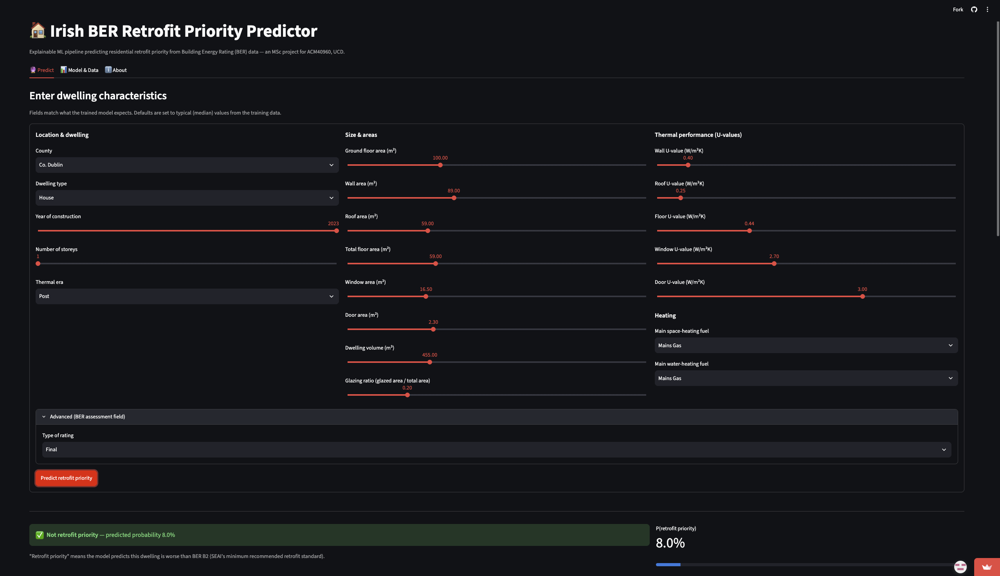
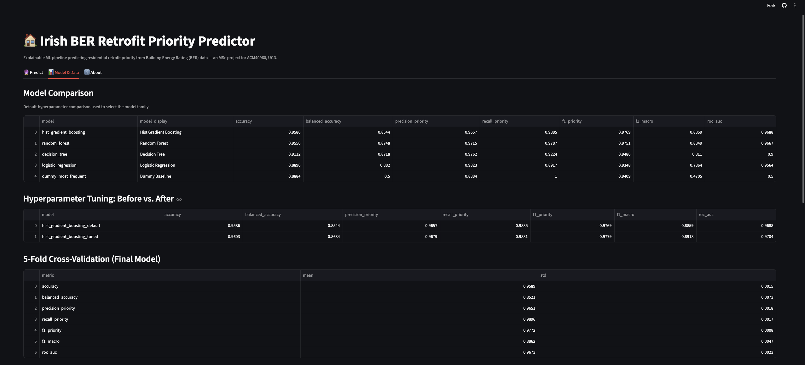

# Explainable Machine Learning for Irish Residential Energy Retrofit Prioritisation Using BER Data


[](https://ml-retrofit-ber.streamlit.app)


**[🚀 Live Dashboard](https://ml-retrofit-ber.streamlit.app)** · **[📖 Full Methodology](docs/METHODOLOGY.md)** · **ACM40960, University College Dublin**

An explainable machine-learning pipeline that predicts whether an Irish
dwelling is an **energy-retrofit priority** from its Building Energy
Rating (BER) data, and explains *why* using SHAP. Trained on 790K+ Irish
dwellings, it reaches 96% accuracy / 0.97 ROC-AUC, and ships as a live,
interactive dashboard — not just a notebook.

Framed as decision support, not a replacement for an official BER
assessment or professional retrofit inspection.

---

## Table of Contents

- [Quick Start](#quick-start)
- [Dataset](#dataset)
- [Target Definition — Why B2?](#target-definition-why-b2)
- [Repository Structure](#repository-structure)
- [Methodology](#methodology)
- [Model Results](#model-results)
- [Explainability](#explainability)
- [Key Interpretation](#key-interpretation)
- [Interactive Dashboard](#interactive-dashboard)
- [Deploying Your Own Copy](#deploying-your-own-copy)
- [Limitations](#limitations)
- [Future Work](#future-work)
- [Authors](#authors)
- [License](#license)
- [References](#references)

---

## Quick Start

```bash
git clone https://github.com/ACM40960/Explainable-Machine-Learning-for-Irish-Residential-Energy-Retrofit-Prioritisation-Using-BER-Data.git
cd Explainable-Machine-Learning-for-Irish-Residential-Energy-Retrofit-Prioritisation-Using-BER-Data
python -m pip install -r requirements.txt
```

Then either try the model instantly (no data download needed — it loads
the pre-trained pipeline already committed to this repo):

```bash
streamlit run app.py
```

...or reproduce the full pipeline from raw data. Download the [cleaned BER
dataset](https://data.mendeley.com/datasets/yhgdzfpnym/1) from Mendeley,
rename it `ber_cleaned_20231005.csv`, and place it at
`data/raw/ber_cleaned_20231005.csv`, then:

```bash
python src/run_pipeline.py
```

This runs data cleaning → EDA → model training/tuning → evaluation →
explainability → results summary end to end, regenerating everything
under `results/` and `models/`. Individual stages can also be run
separately — see [`src/run_pipeline.py`](src/run_pipeline.py) for the
list, or the [Full Methodology](docs/METHODOLOGY.md) doc for the optional
sample-size sensitivity check.

Developed with **Python 3.13.5**; deployed with Python 3.11 (see
[Deploying Your Own Copy](#deploying-your-own-copy)). Dependencies in
[`requirements.txt`](requirements.txt).

---

## Dataset

**Ahern, C., Raushan, K., and Essien-Thompson, E. (2024).** *Irish
Building Energy Rating Database (Cleaned 05/10/2023)*. Mendeley Data,
V1. [DOI: 10.17632/yhgdzfpnym.1](https://doi.org/10.17632/yhgdzfpnym.1)

After cleaning and a target-leakage audit: **790,389 dwellings, 22
features** (county, dwelling type, construction year, floor area,
wall/roof/floor/window/door U-values and areas, heating fuels, glazing %,
volume). Full cleaning steps and the leakage-exclusion table are in
[Full Methodology](docs/METHODOLOGY.md#data-cleaning).

The raw and processed data files are not committed to this repo (too
large) — see [Quick Start](#quick-start) to reproduce them locally.


---

## Target Definition — Why B2?

| Label                  | Condition        |
| ----------------------- | ----------------- |
| Not priority (`0`)      | BER **B2** or better |
| Retrofit priority (`1`) | Worse than B2     |

Class balance: **88.8% priority vs. 11.2% not priority** — imbalanced, so
balanced accuracy and macro F1 are used throughout, not raw accuracy.

**B2 isn't an arbitrary cutoff.** It's SEAI's own recommended minimum
retrofit standard, and the explicit target of Ireland's National Retrofit
Plan — **500,000 homes to B2 by 2030**. A dwelling this model flags as
"priority" is, by definition, one that hasn't yet met the national
retrofit benchmark, so the model's output is interpretable against a
real, publicly stated policy goal rather than an arbitrary statistical
split.

This does simplify a continuous measure (kWh/m²/yr) to one cutoff — a D1
dwelling and a G-rated dwelling both get labelled "priority" despite very
different severity. See [Limitations](#limitations).

Sources: [SEAI – B2 Home Energy Rating](https://www.seai.ie/about/tools/b2-rated-home), [Government of Ireland – National Retrofit Plan](https://www.gov.ie/en/department-of-climate-energy-and-the-environment/publications/national-retrofit-plan/), [Comptroller and Auditor General (2023)](https://www.audit.gov.ie/en/find-report/publications/2023/8-performance-of-certain-residential-retrofit-schemes.pdf).

---

## Repository Structure

```text
├── README.md              ← you are here
├── app.py                 ← Streamlit dashboard
├── requirements.txt
├── LICENSE
├── models/best_model.joblib   ← final trained pipeline (committed, ~1MB)
├── docs/
│   ├── METHODOLOGY.md     ← full methodology & reproducibility notes
│   └── images/            ← dashboard screenshots for this README
├── results/
│   ├── figures/           ← all generated plots
│   └── tables/            ← all generated metrics/audit tables
└── src/
    ├── config.py, data_cleaning.py, eda.py, preprocessing.py
    ├── train_models.py, evaluate_models.py, explainability.py
    ├── results_summary.py, sample_size_experiment.py
    └── run_pipeline.py    ← runs the full pipeline end to end
```

---

## Methodology

```text
Data cleaning & leakage audit → EDA → Preprocessing (impute, scale,
one-hot encode) → 5-model comparison → Hyperparameter tuning & 5-fold CV
→ Explainability (permutation + SHAP) → Streamlit dashboard
```

Five models were compared on a stratified 100K-row sample (80K train /
20K test): a majority-class dummy baseline, Logistic Regression, Decision
Tree, Random Forest, and Hist Gradient Boosting. Hist Gradient Boosting
was selected and then tuned with `RandomizedSearchCV`, validated with
5-fold CV, and checked against the full 790K-row dataset for sample-size
sensitivity.

**Full write-up** (mathematical formulation, leakage-handling table,
feature list, preprocessing detail) → [`docs/METHODOLOGY.md`](docs/METHODOLOGY.md).

---

## Model Results

| Metric                       |  Value |
| ----------------------------- | -----: |
| Accuracy                     | 0.9602 |
| Balanced accuracy            | 0.8634 |
| Retrofit-priority precision  | 0.9679 |
| Retrofit-priority recall     | 0.9881 |
| Macro F1-score               | 0.8918 |
| ROC-AUC                      | 0.9704 |

*Final model: Hist Gradient Boosting, tuned via `RandomizedSearchCV`,
validated with 5-fold cross-validation (macro F1 = 0.886 ± 0.005, closely
matching the test-set score — not a lucky split), and confirmed to hold
(and improve slightly) on the full 790K-row dataset.*

The dummy majority-class baseline reaches 88.8% *accuracy* just by always
predicting the majority class, but scores 0.50 balanced accuracy / 0.50
ROC-AUC — no real discrimination ability, which is why accuracy alone is
not used to judge these models.


**Full results** (before/after tuning table, CV per-fold scores,
sample-size experiment, all baseline model figures) →
[`docs/METHODOLOGY.md`](docs/METHODOLOGY.md#hyperparameter-tuning).

---

## Explainability

Two independent methods — permutation importance and SHAP — were used to
identify which dwelling characteristics drive the model, and **agree
closely**: 8 of the top 10 features are shared between them.

**Top drivers:** window/wall/roof U-values, ground floor area, year of
construction, and water-heating fuel — all physically meaningful and
consistent with building-energy principles, not arbitrary correlations.


*High (red) U-values push predictions toward retrofit priority; low
(blue) U-values push toward not-priority — exactly the expected physical
direction. Points are individual dwellings from a 2,000-row SHAP sample.*

SHAP also explains *individual* predictions in real units (actual
U-values, m²) via waterfall plots — this is what powers the live
explanation in the [dashboard](#interactive-dashboard) below.

**Full comparison** (SHAP vs. permutation methodology, local waterfall
examples, full top-10 tables) →
[`docs/METHODOLOGY.md`](docs/METHODOLOGY.md#shap-methodology).

---

## Key Interpretation

BER data predicts retrofit priority with strong performance (96%
accuracy, 0.97 ROC-AUC), and the features driving those predictions are
exactly the ones building scientists would expect: envelope heat loss,
construction age, and heating systems — not arbitrary statistical
artefacts.

---

## Interactive Dashboard

**Live at: [ml-retrofit-ber.streamlit.app](https://ml-retrofit-ber.streamlit.app)**

A Streamlit app puts the model in front of a user, not just a report. It
loads `models/best_model.joblib` directly at startup — no retraining.

### 🔮 Predict

Full input form for a dwelling's characteristics (county, dwelling type,
year built, U-values, heating fuel, etc.), defaulted to typical values.
Returns the retrofit-priority prediction, its probability, and a live
SHAP waterfall explaining that specific prediction in real units.



### 📊 Model & Data

Comparison tables, tuning/CV results, and key figures — doubles as a
project showcase, not just a predictor.



### ℹ️ About

A general-audience summary of the project, data source, and limitations.

Run it locally with `streamlit run app.py`.

---

## Deploying Your Own Copy

The repo is deployment-ready for [Streamlit Community Cloud](https://streamlit.io/cloud):
push to GitHub → **Create app** → point it at this repo, branch `main`,
main file `app.py` → **set the Python version to 3.11** in Advanced
Settings (important — see why in
[Full Methodology](docs/METHODOLOGY.md#deployment-notes)) → Deploy.

---

## Limitations

- The retrofit-priority label is a simplified binary cutoff of a
  continuous energy-performance measure (see [Why B2?](#target-definition-why-b2)).
- BER data reflects standardised assessment assumptions, not measured
  household energy use.
- The model uses selected dwelling-level variables, not every available
  BER field.
- Most results use a 100,000-row sample — confirmed to hold at full
  scale (see [Full Methodology](docs/METHODOLOGY.md#sample-size-sensitivity)).
- Associations identified are statistical, not causal.
- Further validation would be needed before operational retrofit
  planning use.

---

## Future Work

- Adopt the full dataset as the pipeline default (already shown
  computationally practical).
- Compare alternative or multi-level retrofit-priority thresholds.
- County- or dwelling-type-specific models.
- Regression models for numerical energy-performance indicators.
- Validate against newer BER records as they become available.

---

## Authors

* **Muhammad Raiyan**
* **Qudsia Samar Babu Khadar**

ACM40960: Projects in Mathematical Modelling — University College Dublin

---

## License

This project is licensed under the [MIT License](LICENSE).

---

## References

* Ahern, C., Raushan, K., and Essien-Thompson, E. (2024). [*Irish Building Energy Rating Database (Cleaned 05/10/2023)*](https://data.mendeley.com/datasets/yhgdzfpnym/1). Mendeley Data. DOI: [10.17632/yhgdzfpnym.1](https://doi.org/10.17632/yhgdzfpnym.1).
* Sustainable Energy Authority of Ireland. [Building Energy Rating information](https://www.seai.ie/ber), [B2 Home Energy Rating](https://www.seai.ie/about/tools/b2-rated-home).
* Government of Ireland. [National Retrofit Plan](https://www.gov.ie/en/department-of-climate-energy-and-the-environment/publications/national-retrofit-plan/).
* Office of the Comptroller and Auditor General (2023). [Performance of Certain Residential Retrofit Schemes](https://www.audit.gov.ie/en/find-report/publications/2023/8-performance-of-certain-residential-retrofit-schemes.pdf).
* Lundberg, S. M., and Lee, S. I. (2017). [A Unified Approach to Interpreting Model Predictions](https://arxiv.org/abs/1705.07874). NeurIPS.
* Ribeiro, M. T., Singh, S., and Guestrin, C. (2016). [“Why Should I Trust You?” Explaining the Predictions of Any Classifier](https://arxiv.org/abs/1602.04938). ACM SIGKDD.

**→ For full methodology, experiment justifications, and every generated
output file, see [`docs/METHODOLOGY.md`](docs/METHODOLOGY.md).**
