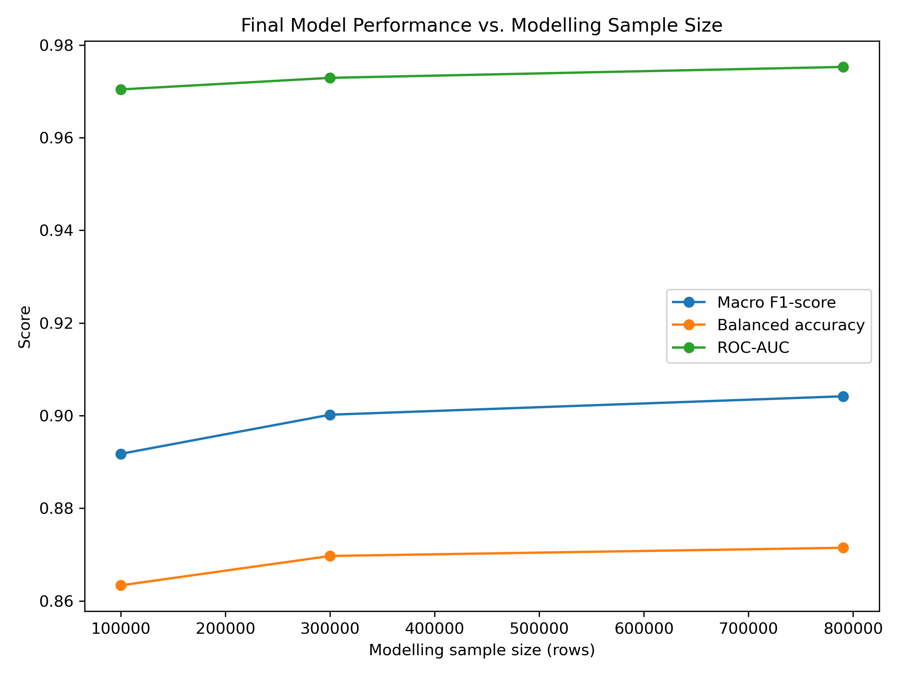
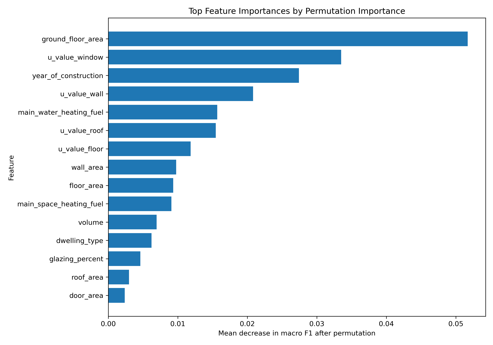
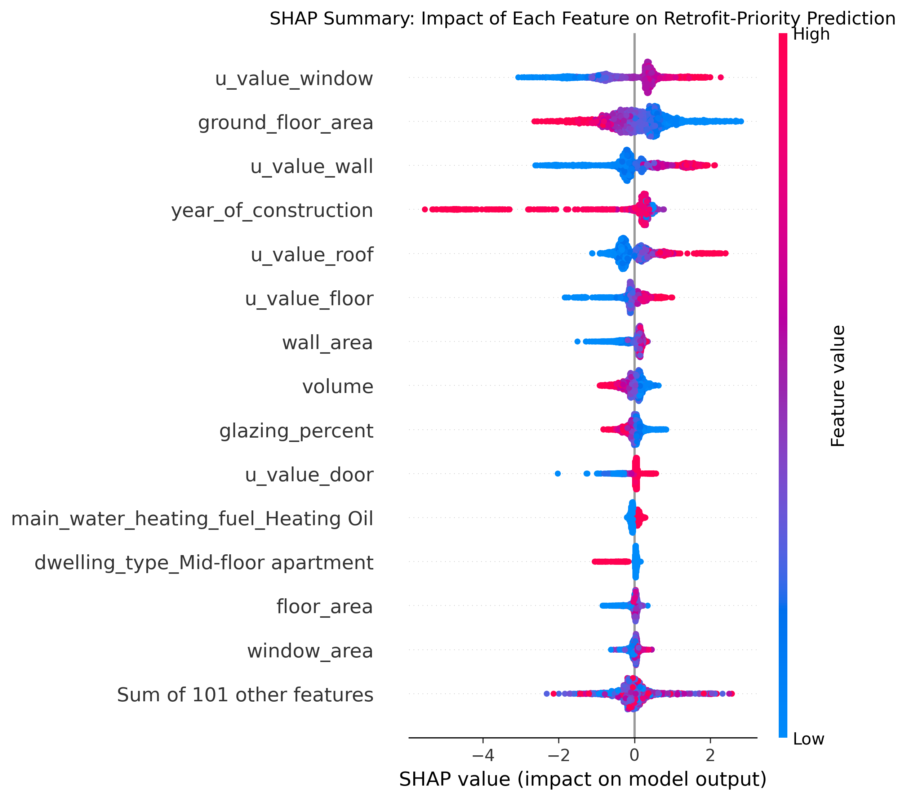
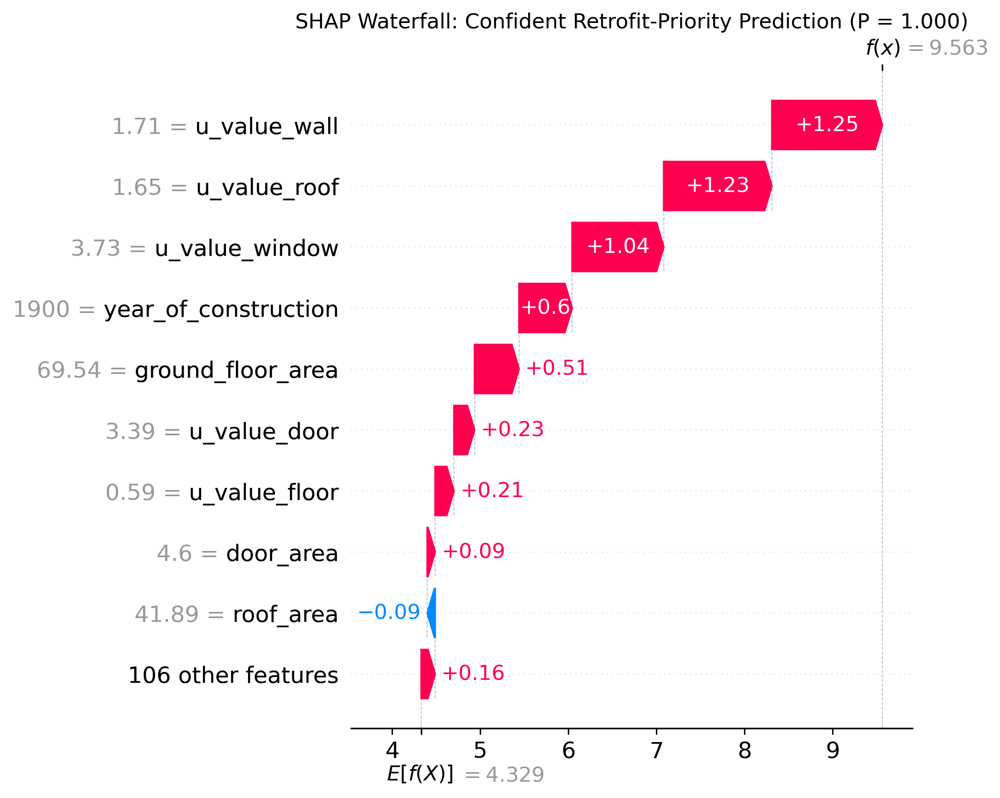
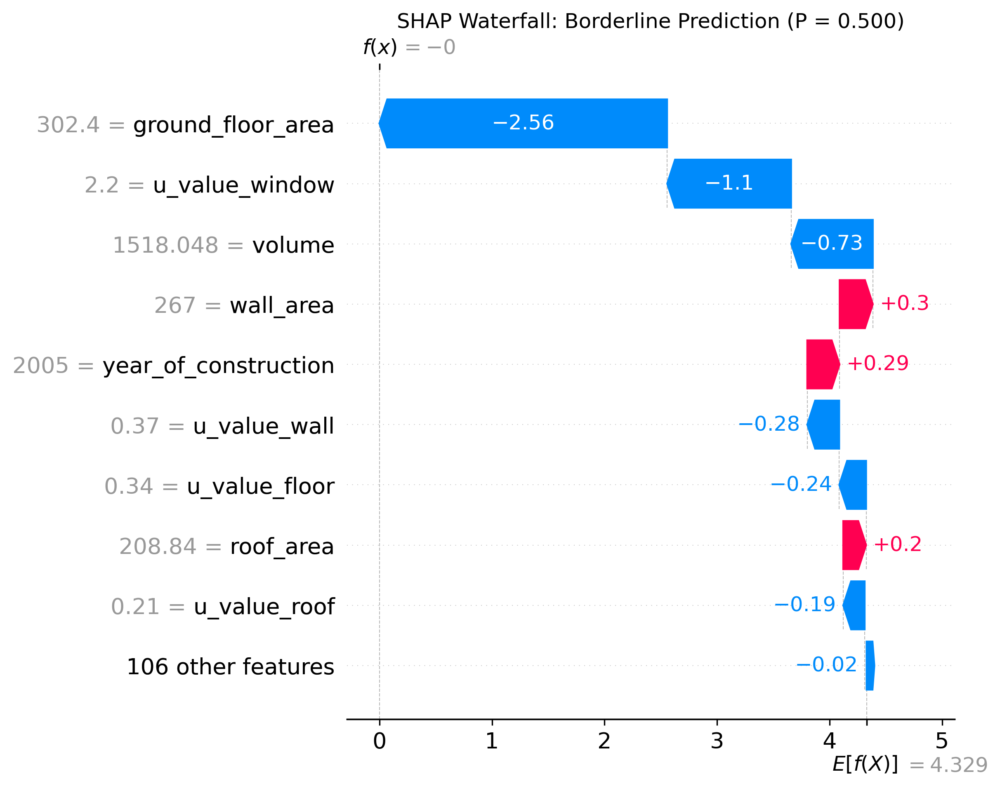

# Explainable Machine Learning for Irish Residential Energy Retrofit Prioritisation Using BER Data

## Project Overview

This project investigates whether Irish Building Energy Rating (BER) data can be used to identify residential dwellings that may require energy retrofit priority.

The project develops a reproducible and explainable machine-learning pipeline that classifies dwellings into:

* **Retrofit priority**
* **Not retrofit priority**

The target is based on BER rating:

* Homes rated **B2 or better** are labelled as **not retrofit priority**.
* Homes rated **worse than B2** are labelled as **retrofit priority**.

This project is framed as a decision-support analysis for residential energy retrofit planning. It is not intended to replace official BER assessment, engineering inspection, or policy decision-making.

---

## Research Question

Can Irish BER data be used to predict residential retrofit priority, and can explainable machine learning identify the main dwelling characteristics associated with poor energy performance?

---

## Mathematical Modelling Formulation

This project is formulated as a supervised binary classification problem.

For each dwelling `i`, the model observes a feature vector `x_i`, which contains physical, geographical, and heating-system characteristics such as dwelling type, county, year of construction, floor area, U-values, heating fuel, glazing percentage, and building-envelope areas.

The response variable is:

```text
y_i = 1 if the dwelling is retrofit priority
y_i = 0 otherwise
```

The modelling objective is to learn a function:

```text
f(x_i) -> y_i
```
For probabilistic classifiers, the model can also be interpreted as estimating the probability `P(y_i = 1 | x_i)`, where larger values indicate higher predicted retrofit-priority risk.

that predicts whether a dwelling should be classified as retrofit priority based on its observed characteristics.

The problem is evaluated on a held-out test set using accuracy, balanced accuracy, macro F1-score, ROC-AUC, precision, recall, and confusion matrices. Because the target variable is imbalanced, balanced accuracy and macro F1-score are treated as more informative than accuracy alone.

---

## Motivation

Residential energy efficiency is an important part of Ireland’s sustainability and climate-transition agenda. Many Irish homes differ in construction age, dwelling type, floor area, insulation quality, heating systems, glazing, and energy performance.

Because it is not practical to retrofit all homes immediately, a data-driven approach can help explore which dwelling characteristics are most associated with poor energy performance.

This project uses machine learning to predict retrofit-priority status and explain the main features influencing those predictions.

---

## Dataset

The project uses the cleaned Irish Building Energy Rating dataset:

**Ahern, C., Raushan, K., and Essien-Thompson, E. (2024). *Irish Building Energy Rating Database - (Cleaned 05/10/2023)*. Mendeley Data, Version 1. DOI: 10.17632/yhgdzfpnym.1**

The dataset contains a cleaned pull from the Irish BER database dated 5 October 2023. The file used locally in this project is:

```text
BER (filtered and cleaned 20231005).csv
```

For coding consistency, the dataset file should be renamed locally as:

```text
ber_cleaned_20231005.csv
```

The raw dataset is not included in this GitHub repository because it is large. To reproduce the project, download the dataset separately from Mendeley Data and place it at:

```text
data/raw/ber_cleaned_20231005.csv
```

The processed modelling dataset is generated automatically by the cleaning pipeline and saved locally to:

```text
data/processed/ber_model_ready.csv
```

Both raw and processed data files are excluded from version control using `.gitignore`.

After cleaning and target creation, the model-ready dataset contains:

```text
790,389 rows
22 columns
```
---

## Target Definition

The binary target variable is:

```text
retrofit_priority
```

The target is created from the `EnergyRating` column.

```text
retrofit_priority = 0
if BER rating is A1, A2, A3, B1, or B2

retrofit_priority = 1
if BER rating is B3, C1, C2, C3, D1, D2, E1, E2, F, or G
```

This means homes worse than BER B2 are treated as retrofit-priority dwellings.

Target distribution:

```text
Retrofit priority:     88.84%
Not retrofit priority: 11.16%
```

Because the target is imbalanced, the project evaluates models using balanced accuracy, macro F1-score, ROC-AUC, precision, recall, and confusion matrices rather than accuracy alone.

---

## Threshold Justification: Why B2

The BER scale bands a dwelling's primary energy demand (kWh/m²/yr) from A1 (most efficient) to G (least efficient). The bands immediately around the chosen cutoff are:

| Band | Primary energy demand (kWh/m²/yr) |
| ---- | ---------------------------------: |
| B1   |                             75-100 |
| B2   |                            100-125 |
| B3   |                            125-150 |

B2 was chosen as the retrofit-priority cutoff for two reasons, both tied to existing SEAI guidance rather than an arbitrary modelling choice:

1. **It is SEAI's own recommended minimum standard.** SEAI advises homeowners upgrading an older home to aim for a minimum BER of B2, treating it as the benchmark for an energy-efficient, comfortable home.
2. **It is the explicit target band in national retrofit policy.** Ireland's Climate Action Plan and the National Retrofit Plan set a target of upgrading 500,000 existing homes to a BER of B2 (or "cost-optimal") by 2030, with an interim target of 120,000 homes by the end of 2025. B2 is therefore not just a technical rating band — it is the specific bar Irish retrofit policy is measured against.

Defining `retrofit_priority = 0` for B2-or-better and `retrofit_priority = 1` for worse-than-B2 means the model's binary label lines up directly with this policy benchmark: a dwelling the model flags as "retrofit priority" is, by definition, a dwelling that has not yet reached the national retrofit target. This makes the model's output directly interpretable against a real, publicly stated policy goal, rather than an arbitrary statistical split of the data.

This is a simplification worth being explicit about: the underlying energy-performance measure is continuous (kWh/m²/yr), and collapsing it to a single binary cutoff discards information about how far below B2 a dwelling falls (e.g. a D1 dwelling and a G dwelling are both labelled "retrofit priority" despite very different severity). This trade-off, and possible extensions such as testing alternative or multi-level thresholds, is discussed further in [Limitations](#limitations) and [Future Work](#future-work).

Sources: [SEAI – B2 Home Energy Rating](https://www.seai.ie/about/tools/b2-rated-home), [Government of Ireland – National Retrofit Plan](https://www.gov.ie/en/department-of-climate-energy-and-the-environment/publications/national-retrofit-plan/), [Comptroller and Auditor General – Performance of Certain Residential Retrofit Schemes (2023)](https://www.audit.gov.ie/en/find-report/publications/2023/8-performance-of-certain-residential-retrofit-schemes.pdf).

---

## Project Workflow

```text
Raw BER data
    ↓
Data cleaning and quality checks
    ↓
Target creation
    ↓
Leakage audit and feature selection
    ↓
Exploratory data analysis
    ↓
Preprocessing pipeline
    ↓
Model training and baseline comparison
    ↓
Final model evaluation
    ↓
Explainability analysis
    ↓
Results summary
```

---

## Repository Structure

```text
Explainable-Machine-Learning-for-Irish-Residential-Energy-Retrofit-Prioritisation-Using-BER-Data/
│
├── README.md
├── app.py
├── requirements.txt
├── .gitignore
│
├── data/
│   ├── raw/
│   └── processed/
│
├── docs/
│   └── project_log.md
│
├── models/
│   └── best_model.joblib
│
├── notebooks/
│   └── 01_data_inspection.ipynb
│
├── reports/
│   └── Literature_Review.pdf
│
├── results/
│   ├── figures/
│   └── tables/
│
└── src/
    ├── config.py
    ├── data_cleaning.py
    ├── eda.py
    ├── preprocessing.py
    ├── train_models.py
    ├── evaluate_models.py
    ├── explainability.py
    ├── results_summary.py
    ├── sample_size_experiment.py
    └── run_pipeline.py
```

---

## Tech Stack

* Python
* pandas
* NumPy
* scikit-learn
* SHAP
* matplotlib
* seaborn
* joblib
* Jupyter Notebook
* Git
* GitHub

No cloud tools such as AWS, Airflow, or SageMaker are required for this project. The project is published as a reproducible GitHub repository with an end-to-end local pipeline.

---

## Data Cleaning

The data-cleaning pipeline is implemented in:

```text
src/data_cleaning.py
```

The cleaning stage performs the following steps:

1. Loads selected columns from the raw BER dataset.
2. Renames columns into consistent snake_case format.
3. Converts numerical fields into valid numeric types.
4. Converts placeholder missing values such as blank strings, `NA`, `nan`, `None`, and similar values into proper missing values.
5. Applies data-quality rules for:

   * invalid construction years;
   * invalid U-values;
   * invalid physical area values;
   * invalid glazing percentages;
   * invalid volume values;
   * invalid storey counts.
6. Creates the binary `retrofit_priority` target.
7. Removes target-leakage columns from the modelling dataset.
8. Saves a model-ready dataset locally.
9. Saves audit tables for cleaning, missingness, leakage, and selected-feature rationale.

Important generated audit files:

```text
results/tables/cleaning_summary.csv
results/tables/data_quality_audit.csv
results/tables/leakage_audit.csv
results/tables/selected_features_rationale.csv
results/tables/missingness_after_cleaning.csv
```

---

## Leakage Handling

Because the target is derived from BER rating, care was taken to avoid target leakage.

The following columns were excluded from the modelling features:

| Column                   | Decision           | Reason                                                           |
| ------------------------ | ------------------ | ---------------------------------------------------------------- |
| `EnergyRating`           | Target source only | Used to define `retrofit_priority`, then removed from predictors |
| `BerRating`              | Dropped            | Numerical BER score closely determines the BER band              |
| `CO2Rating`              | Dropped            | BER-related assessment output                                    |
| `TotalCO2Emissions`      | Dropped            | Calculated energy-performance output                             |
| `TotalPrimaryEnergyFact` | Dropped            | Calculated energy-performance output                             |
| `MPCDERValue`            | Dropped            | Derived assessment value                                         |
| `EPCDERValue`            | Dropped            | Derived assessment value                                         |

This prevents the model from learning directly from variables that reveal the BER outcome.

---

## Selected Modelling Features

The model uses physical, dwelling-level, and heating-system variables such as:

* county;
* dwelling type;
* year of construction;
* rating type;
* ground floor area;
* wall, roof, floor, window, and door U-values;
* wall, roof, floor, window, and door areas;
* number of storeys;
* main space-heating fuel;
* main water-heating fuel;
* thermal era;
* glazing percentage;
* volume.

The derived feature `building_age` was not used because it is directly calculated from `year_of_construction`. To avoid redundant predictors and improve interpretability, the project keeps `year_of_construction` only.

---

## Exploratory Data Analysis

The EDA stage is implemented in:

```text
src/eda.py
```

It generates summary tables and figures to understand the dataset before modelling.

Key EDA outputs include:

* BER rating distribution;
* retrofit-priority class distribution;
* county distribution;
* dwelling type distribution;
* heating fuel distribution;
* missingness summary;
* construction year distribution;
* ground floor area distribution;
* priority rate by dwelling type;
* priority rate by heating fuel;
* numerical feature comparisons by target class.

Example figures:

### BER Rating Distribution


### Retrofit Priority Class Distribution


### Top Missingness Rates


### Ground Floor Area by Retrofit-Priority Class


### Year of Construction by Retrofit-Priority Class


---

## Machine-Learning Pipeline

The machine-learning pipeline uses `scikit-learn` tools for reproducible preprocessing and modelling.

Main files:

```text
src/preprocessing.py
src/train_models.py
src/evaluate_models.py
```

The preprocessing pipeline uses:

* `ColumnTransformer`;
* numerical imputation;
* numerical scaling;
* categorical imputation;
* one-hot encoding;
* stratified train-test splitting.

A stratified sample of 100,000 rows is used for modelling. This keeps training computationally efficient while preserving the class distribution.

The train-test split is:

```text
Training rows: 80,000
Test rows:     20,000
```

---

## Models Used

The project compares a dummy baseline with four machine-learning models:

1. Dummy majority-class baseline
2. Logistic Regression
3. Decision Tree
4. Random Forest
5. Hist Gradient Boosting

The dummy baseline is important because the target is imbalanced. Since most dwellings are retrofit priority, a naive model that always predicts the majority class can achieve high accuracy without learning meaningful patterns.

---

## Evaluation Metrics

The project uses:

* accuracy;
* balanced accuracy;
* precision for retrofit-priority class;
* recall for retrofit-priority class;
* F1-score for retrofit-priority class;
* macro F1-score;
* ROC-AUC;
* confusion matrix.

Accuracy alone is not sufficient because the dataset is imbalanced. Macro F1-score, balanced accuracy, and ROC-AUC give a more reliable view of model performance.

---

## Model Results

The best-performing model was:

```text
Hist Gradient Boosting
```

Hist Gradient Boosting was selected as the final model because it achieved the highest macro F1-score and ROC-AUC among the non-baseline models, while also maintaining very high recall for retrofit-priority dwellings. Although Random Forest achieved slightly higher balanced accuracy, Hist Gradient Boosting provided the strongest overall trade-off for this project. Its hyperparameters were then tuned (see below); the tuned version is the model actually shipped in this repository.

Full model comparison (default hyperparameters, used for model-family selection):

| Model                  | Accuracy | Balanced Accuracy | Priority Recall | Macro F1-score | ROC-AUC |
| ---------------------- | -------: | ----------------: | --------------: | -------------: | ------: |
| Dummy Baseline         |   0.8884 |            0.5000 |          1.0000 |         0.4705 |  0.5000 |
| Logistic Regression    |   0.8896 |            0.8820 |          0.8917 |         0.7864 |  0.9564 |
| Decision Tree          |   0.9112 |            0.8718 |          0.9224 |         0.8110 |  0.9000 |
| Random Forest          |   0.9556 |            0.8748 |          0.9787 |         0.8849 |  0.9667 |
| Hist Gradient Boosting |   0.9586 |            0.8544 |          0.9885 |         0.8859 |  0.9688 |

The dummy majority-class baseline achieved high accuracy because most dwellings in the dataset are labelled as retrofit priority. However, its balanced accuracy and ROC-AUC are both 0.5000, showing that it has no real discrimination ability. This demonstrates why accuracy alone is misleading for this imbalanced classification task.

The machine-learning models substantially improve balanced accuracy, macro F1-score, and ROC-AUC compared with the dummy baseline. This suggests that the models learn meaningful relationships between dwelling characteristics and retrofit-priority status.

### Hyperparameter Tuning

Implemented in `tune_hist_gradient_boosting()` in [`src/train_models.py`](src/train_models.py).

Once Hist Gradient Boosting was selected as the best-performing model family (using its default hyperparameters above), it was further tuned with `RandomizedSearchCV`:

* 25 randomly sampled hyperparameter candidates;
* 5-fold stratified cross-validation on the training split (80,000 rows);
* scored by macro F1, consistent with the metric used for model-family selection;
* search space: `learning_rate` (log-uniform, 0.01-0.3), `max_iter` (100-400), `max_leaf_nodes` (15-127), `min_samples_leaf` (10-99), `l2_regularization` (0-2).

Best hyperparameters found (best CV macro F1 = 0.8872):

| Hyperparameter     |     Best Value |
| ------------------- | --------------: |
| `learning_rate`     |           0.138 |
| `max_iter`           |             360 |
| `max_leaf_nodes`     |             120 |
| `min_samples_leaf`   |              50 |
| `l2_regularization`  |            1.458 |

Before vs. after tuning, evaluated on the same held-out test set:

| Metric                      | Default | Tuned  |
| ---------------------------- | ------: | -----: |
| Accuracy                    |  0.9586 | 0.9602 |
| Balanced accuracy           |  0.8544 | 0.8634 |
| Retrofit-priority precision |  0.9657 | 0.9679 |
| Retrofit-priority recall    |  0.9885 | 0.9881 |
| Retrofit-priority F1-score  |  0.9769 | 0.9779 |
| Macro F1-score              |  0.8859 | 0.8918 |
| ROC-AUC                     |  0.9688 | 0.9704 |

Full results: [`results/tables/hgb_tuning_before_after.csv`](results/tables/hgb_tuning_before_after.csv) and [`results/tables/hgb_best_params.csv`](results/tables/hgb_best_params.csv).

Tuning improved every metric except retrofit-priority recall, which dropped marginally (0.9885 to 0.9881, a 4-in-10,000 change). Balanced accuracy showed the largest gain (+0.009), meaning the tuned model is somewhat better at avoiding false positives on the minority (not-priority) class without sacrificing the model's high sensitivity to retrofit-priority dwellings. Because the tuned model is at least as good as the default on every metric that matters for this project, it replaces the default-hyperparameter model as the final saved pipeline (`models/best_model.joblib`) used throughout the rest of this project, including the explainability analysis below.

Final best-model performance (tuned Hist Gradient Boosting):

| Metric                      |  Value |
| --------------------------- | -----: |
| Accuracy                    | 0.9602 |
| Balanced accuracy           | 0.8634 |
| Retrofit-priority precision | 0.9679 |
| Retrofit-priority recall    | 0.9881 |
| Retrofit-priority F1-score  | 0.9779 |
| Macro F1-score              | 0.8918 |
| ROC-AUC                     | 0.9704 |

### Cross-Validation (5-Fold)

Implemented in `run_cross_validation()` in [`src/evaluate_models.py`](src/evaluate_models.py).

The table above reports performance on a single 80/20 stratified train-test split, which is how the final model is actually evaluated for deployment (trained once on the training rows, scored once on rows it has never seen). A single split is simple and matches how the model would really be trained and shipped, but it only gives one sample of performance, so it can't show how much that performance might vary with a different random split of the data.

To check that result isn't a lucky (or unlucky) split, 5-fold stratified cross-validation was also run, using the same tuned hyperparameters, on the training portion of the data only (80,000 rows; the held-out test set was kept completely untouched for the single-split evaluation above). Each fold trains a fresh copy of the full pipeline (preprocessing + Hist Gradient Boosting) from scratch and evaluates it on the remaining fold.

5-fold cross-validation results (mean ± std across folds):

| Metric                      |   Mean | Std    |
| ---------------------------- | -----: | -----: |
| Accuracy                    | 0.9589 | 0.0015 |
| Balanced accuracy           | 0.8521 | 0.0073 |
| Retrofit-priority precision | 0.9651 | 0.0018 |
| Retrofit-priority recall    | 0.9896 | 0.0017 |
| Retrofit-priority F1-score  | 0.9772 | 0.0008 |
| Macro F1-score              | 0.8862 | 0.0047 |
| ROC-AUC                     | 0.9673 | 0.0023 |

Full results: [`results/tables/cv_5fold_summary.csv`](results/tables/cv_5fold_summary.csv) (mean/std) and [`results/tables/cv_5fold_raw_scores.csv`](results/tables/cv_5fold_raw_scores.csv) (per-fold scores).

The cross-validated means are close to the single-split test metrics (within roughly 0.01-0.02 on every metric) and the standard deviations are small (all under 0.01), so the single-split test performance reported above is not an artefact of a favourable split. Both are shown because they answer different questions: the single-split test set reflects the actual final model's performance on genuinely unseen data, while cross-validation reflects the stability of Hist Gradient Boosting with these hyperparameters across different random partitions of the training data.

### Model Comparison by Macro F1-Score


### Model Comparison by ROC-AUC


### Model Comparison by Retrofit-Priority Recall


### Sample-Size Sensitivity

Implemented in [`src/sample_size_experiment.py`](src/sample_size_experiment.py) (a standalone, optional script — not part of the main `run_pipeline.py`).

All results above use a stratified 100,000-row sample of the 790,389-row model-ready dataset, mainly for fast iteration during development. To check whether this choice affects the results, the final tuned Hist Gradient Boosting pipeline (same hyperparameters, fresh 80/20 split each time) was re-trained from scratch on three sample sizes: 100,000 rows, 300,000 rows, and the full dataset.

| Sample size | Train rows | Fit time | Accuracy | Balanced Accuracy | Macro F1 | ROC-AUC |
| ----------: | ---------: | -------: | -------: | -----------------: | -------: | ------: |
|     100,000 |     80,000 |    2.2 s |   0.9603 |              0.8634 |   0.8918 |  0.9704 |
|     300,000 |    240,000 |    7.4 s |   0.9635 |              0.8697 |   0.9002 |  0.9729 |
| 790,389 (full) |  632,311 |   38.8 s |   0.9651 |              0.8715 |   0.9042 |  0.9753 |

Full results: [`results/tables/sample_size_comparison.csv`](results/tables/sample_size_comparison.csv).



Training on the full dataset was very fast (under 40 seconds) — Hist Gradient Boosting scales well, so compute was not actually a constraint here. Every metric improves modestly and monotonically with more data (macro F1: +0.008 from 100k to 300k, +0.004 from 300k to full), with diminishing returns as sample size grows. This confirms the results reported throughout this project are not an artefact of the smaller 100,000-row sample — they hold, and improve slightly, at full scale. The 100,000-row sample is kept as the basis for all other reported results (model comparison, tuning, cross-validation, explainability) for consistency and faster iteration, since the difference in performance is small relative to the difference in runtime for the more expensive steps (RandomizedSearchCV and SHAP).

---

## Explainability Analysis

Explainability is implemented in:

```text
src/explainability.py
```

Two complementary explainability methods are used: permutation importance (global, model-agnostic) and SHAP (global and local, based on the model's internal structure). Permutation importance was used to identify which original dwelling features most influenced model performance.

Permutation importance measures how much the model performance decreases when the values of one feature are randomly shuffled. If shuffling a feature causes a large drop in performance, the model is relying strongly on that feature.

This method was chosen because it is model-agnostic and can be applied to the final trained pipeline without needing to inspect model-specific internal parameters.

Top 10 features by permutation importance (computed on the final tuned model):

| Rank | Feature                    | Interpretation                                                                                  |
| ---: | --------------------------- | ------------------------------------------------------------------------------------------------ |
|    1 | `ground_floor_area`         | Larger or smaller dwelling size affects heating demand and energy performance.                  |
|    2 | `u_value_window`            | Window thermal transmittance affects heat loss through glazing.                                 |
|    3 | `year_of_construction`      | Construction period is linked to building standards and insulation quality.                     |
|    4 | `u_value_wall`               | Wall thermal performance affects heat loss through the building envelope.                       |
|    5 | `main_water_heating_fuel`    | Water-heating fuel type is related to energy-system efficiency.                                 |
|    6 | `u_value_roof`               | Roof thermal performance affects heat loss through the roof or attic.                           |
|    7 | `u_value_floor`              | Floor thermal performance affects heat loss through floors.                                     |
|    8 | `wall_area`                  | Larger wall area can increase total envelope heat loss.                                         |
|    9 | `floor_area`                 | Floor area represents building size and contributes to energy-demand differences.               |
|   10 | `main_space_heating_fuel`    | Space-heating fuel type is related to energy-system efficiency and emissions.                   |

These features are physically meaningful because they relate to dwelling size, construction age, heat loss through the building envelope, heating systems, and dwelling form.

This supports the interpretability of the model because the strongest predictors are consistent with building-energy principles rather than arbitrary or unexplained variables.

A limitation of permutation importance is that correlated features can share importance. Therefore, the results should be interpreted as evidence of model reliance, not as proof of direct causal effects.

### Permutation Importance



### SHAP Explainability

In addition to permutation importance, the project uses SHAP (SHapley Additive exPlanations) to explain the final Hist Gradient Boosting pipeline. SHAP assigns each feature a contribution value for every individual prediction, based on cooperative game theory, so it supports both global feature-importance summaries and local, prediction-level explanations.

SHAP values were computed with `TreeExplainer` on a stratified sample of 2,000 test-set rows. Because the preprocessing pipeline one-hot encodes categorical columns, SHAP values are computed on the encoded matrix and then mapped back to original feature names: one-hot columns belonging to the same categorical feature (e.g. `dwelling_type_Detached house`, `dwelling_type_Semi-detached house`, ...) are summed to a single mean absolute SHAP value per original feature, and numeric features are shown with their original, unscaled values (e.g. real U-values and m² areas) rather than the standardised values the model actually sees. This keeps the SHAP outputs directly comparable with the permutation importance table above, which also operates on original feature columns.

Top 10 features by mean absolute SHAP value (computed on the final tuned model):

| Rank | Feature                    | Mean \|SHAP\| |
| ---: | --------------------------- | ------------: |
|    1 | `u_value_window`            |          0.744 |
|    2 | `year_of_construction`      |          0.689 |
|    3 | `ground_floor_area`         |          0.637 |
|    4 | `u_value_wall`               |          0.563 |
|    5 | `u_value_roof`               |          0.379 |
|    6 | `u_value_floor`              |          0.288 |
|    7 | `main_water_heating_fuel`    |          0.241 |
|    8 | `county_name`                |          0.188 |
|    9 | `wall_area`                  |          0.184 |
|   10 | `volume`                     |          0.173 |

Full results: [`results/tables/shap_feature_importance.csv`](results/tables/shap_feature_importance.csv) and [`results/tables/shap_vs_permutation_importance.csv`](results/tables/shap_vs_permutation_importance.csv).

#### Global Summary (Beeswarm)



Each point is one dwelling; its position shows the SHAP value (impact on the model's retrofit-priority score) and its colour shows the underlying feature value. High (red) window, wall, and roof U-values push predictions toward retrofit priority, while low (blue) U-values push toward not-priority, confirming these thermal-transmittance features drive the model in the physically expected direction.

#### Local Explanations

Two individual predictions were explained with SHAP waterfall plots:

**Confidently retrofit-priority (P = 1.000):**



This is a dwelling built in 1900 with very poor U-values across wall (1.71), roof (1.65), window (3.73), and door (3.39) — all far worse than modern building-regulation standards — which together push the prediction strongly toward retrofit priority.

**Borderline prediction (P = 0.500):**



This dwelling shows conflicting evidence: it is a large home (302 m² ground floor area, 1,518 m³ volume) with generally good U-values (window 2.2, wall 0.37, floor 0.34, roof 0.21), which pushes toward not-priority. However its larger-than-typical wall and roof areas and a comparatively recent (2005) construction year push slightly the other way, leaving the prediction almost exactly on the 0.5 decision boundary.

#### SHAP vs Permutation Importance

The two methods agree closely: 8 of the top 10 features are shared between them (`ground_floor_area`, `u_value_window`, `year_of_construction`, `u_value_wall`, `main_water_heating_fuel`, `u_value_roof`, `u_value_floor`, `wall_area`). SHAP additionally surfaces `county_name` and `volume` in its top 10, while permutation importance instead surfaces `floor_area` and `main_space_heating_fuel`. The two methods disagree mainly on ranking order rather than which features matter — permutation importance ranks `ground_floor_area` first (largest drop in macro F1 when shuffled), while SHAP ranks `u_value_window` first (largest average contribution to individual predictions). This is expected: permutation importance measures the effect on overall model *performance*, while SHAP measures the average magnitude of each feature's contribution to individual model *outputs*, so a feature can be highly influential on individual predictions without being the single most damaging feature to shuffle, and vice versa. The consistency between the two independent methods increases confidence that these dwelling-envelope and construction-year features are genuinely driving the model, rather than being an artefact of one particular importance method.

---

## Key Interpretation

The results suggest that BER data can be used to classify retrofit-priority dwellings with strong predictive performance.

The best model, Hist Gradient Boosting, achieved high recall for retrofit-priority dwellings. This is important because a retrofit-prioritisation model should identify as many poor-performing dwellings as possible.

The explainability analysis showed that the most influential features are related to building size, thermal transmittance, construction year, heating fuel, and envelope area. These variables are consistent with known building-energy principles.

---

## Saved Model for Deployment

The final trained pipeline (preprocessing + tuned Hist Gradient Boosting model) is saved to:

```text
models/best_model.joblib
```

This file is produced by `src/train_models.py` and is committed to this repository (it is the one exception carved out of the `models/*.joblib` rule in `.gitignore`) so that the model can be loaded directly, without retraining, by anything that needs predictions — including the Streamlit dashboard. At roughly 1 MB, it is small enough to ship safely in the repository.

```python
import joblib

pipeline = joblib.load("models/best_model.joblib")
prediction = pipeline.predict(new_dwelling_df)          # 0 = not priority, 1 = retrofit priority
probability = pipeline.predict_proba(new_dwelling_df)[:, 1]
```

**SHAP explainer:** rather than also persisting a fitted SHAP explainer object, the explainer is reconstructed on the fly from the loaded model:

```python
import shap

explainer = shap.TreeExplainer(pipeline.named_steps["model"])
```

This is deliberate, not a shortcut: `shap.TreeExplainer` reads the trained tree structure directly from the model object, so building it involves no retraining or refitting on data — it takes under 50ms, regardless of dataset size. Saving a second serialized explainer file alongside the model would duplicate the same tree information for no runtime benefit, so reconstructing it at startup is both simpler and lighter than persisting one.

---

## How to Run the Project
## Setup Notes

Before running the pipeline, make sure the required folder structure exists locally:

- data/raw/
- data/processed/
- results/figures/
- results/tables/
- models/

The raw BER dataset should be placed inside data/raw/ using the expected file name:

ber_cleaned_20231005.csv

The generated processed files, figures, tables, and trained models are created when the pipeline is run locally.

This project was developed using:

```text
Python 3.13.5
```

The Python dependencies are listed in:

```text
requirements.txt
```

The main packages used are `pandas`, `numpy`, `scikit-learn`, `shap`, `matplotlib`, `seaborn`, `jupyter`, `joblib`, and `openpyxl`.

### 1. Clone the repository

```bash
git clone https://github.com/ACM40960/Explainable-Machine-Learning-for-Irish-Residential-Energy-Retrofit-Prioritisation-Using-BER-Data.git
cd Explainable-Machine-Learning-for-Irish-Residential-Energy-Retrofit-Prioritisation-Using-BER-Data
```

### 2. Install requirements

```bash
python -m pip install -r requirements.txt
```

### 3. Add the raw dataset

Download the cleaned BER dataset from Mendeley Data and rename the file to:

```text
ber_cleaned_20231005.csv
```

Place it in:

```text
data/raw/ber_cleaned_20231005.csv
```

The raw dataset is not committed to this repository because it is large.

### 4. Run the full pipeline

```bash
python src/run_pipeline.py
```

This command runs the complete project workflow:

```text
data cleaning
exploratory data analysis
model training
final model evaluation
explainability analysis
results summary
```

The final processed dataset, trained model, figures, and result tables are generated locally.

### Optional: Run each stage separately

```bash
python src/data_cleaning.py
python src/eda.py
python src/train_models.py
python src/evaluate_models.py
python src/explainability.py
python src/results_summary.py
```

### Optional: Sample-size sensitivity check

Not part of the main pipeline above; re-trains the final model on 100k/300k/full-dataset samples to check results hold at scale (see [Sample-Size Sensitivity](#sample-size-sensitivity)). Requires `src/train_models.py` to have already been run at least once, since it reuses the tuned hyperparameters saved in `models/best_model.joblib`.

```bash
python src/sample_size_experiment.py
```

---

## Dashboard

A Streamlit dashboard at [`app.py`](app.py) turns the project into an interactive demo. It loads `models/best_model.joblib` at startup (no retraining) and has three tabs:

* **🔮 Predict** — a form covering every feature the model expects (county, dwelling type, year of construction, floor/wall/roof/window areas, U-values, glazing ratio, heating fuel, etc.), defaulted to typical (median) values from the training data. Submitting it shows the retrofit-priority prediction, its probability, and a live SHAP waterfall plot explaining that specific prediction in real units (not standardised values).
* **📊 Model & Data** — the static model comparison, tuning, and cross-validation tables, plus a few EDA and explainability figures, so the dashboard doubles as a project showcase rather than just a predictor.
* **ℹ️ About** — a short summary of the project, data source, B2 threshold rationale, and limitations (condensed from this README, not duplicated verbatim).

Run it locally with:

```bash
streamlit run app.py
```

See [Deployment](#deployment) below for steps to deploy this on Streamlit Community Cloud.

---

## Main Output Files

### Tables

```text
results/tables/cleaning_summary.csv
results/tables/data_quality_audit.csv
results/tables/leakage_audit.csv
results/tables/selected_features_rationale.csv
results/tables/model_metrics.csv
results/tables/model_metrics_rounded.csv
results/tables/best_model_evaluation_summary.csv
results/tables/best_model_classification_report.csv
results/tables/best_model_confusion_matrix.csv
results/tables/hgb_tuning_before_after.csv
results/tables/hgb_best_params.csv
results/tables/cv_5fold_summary.csv
results/tables/cv_5fold_raw_scores.csv
results/tables/sample_size_comparison.csv
results/tables/permutation_importance.csv
results/tables/shap_feature_importance.csv
results/tables/shap_vs_permutation_importance.csv
results/tables/top_features_rounded.csv
results/tables/key_results_summary.txt
```

### Figures

```text
results/figures/ber_rating_distribution.png
results/figures/target_distribution.png
results/figures/top_missingness_model_ready.png
results/figures/ground_floor_area_by_target.png
results/figures/year_of_construction_by_target.png
results/figures/u_value_window_by_target.png
results/figures/u_value_wall_by_target.png
results/figures/u_value_roof_by_target.png
results/figures/model_comparison_macro_f1.png
results/figures/model_comparison_roc_auc.png
results/figures/model_comparison_priority_recall.png
results/figures/confusion_matrix_hist_gradient_boosting_tuned.png
results/figures/roc_curve_hist_gradient_boosting_tuned.png
results/figures/sample_size_comparison.png
results/figures/permutation_importance_top_features.png
results/figures/shap_summary_beeswarm.png
results/figures/shap_waterfall_confident_priority.png
results/figures/shap_waterfall_borderline.png
```

---

## Limitations

This project should be interpreted as a data-driven decision-support analysis, not as a replacement for official BER assessment or professional retrofit inspection.

Main limitations:

* The retrofit-priority label is derived from BER rating and is a simplified modelling definition.
* BER data is based on standardised assessment assumptions, not actual household energy consumption.
* The model uses selected dwelling-level variables rather than every available BER field.
* Some BER fields were excluded because of missingness, interpretation difficulty, or leakage risk.
* Most results in this project (model comparison, tuning, cross-validation, explainability) are based on a stratified sample of 100,000 rows, chosen for faster iteration and to keep the more expensive steps (hyperparameter search, SHAP) practical during development. A [sample-size sensitivity check](#sample-size-sensitivity) confirms results hold, and improve slightly, on the full 790,389-row dataset.
* The analysis identifies statistical associations, not direct causal effects.
* Further validation would be needed before using this type of model in operational retrofit planning.

---

## Future Work

Possible extensions include:

* adopt the full dataset as the default for the main pipeline (model comparison, tuning, and explainability), now that the [sample-size sensitivity check](#sample-size-sensitivity) shows this is computationally practical;
* compare different retrofit-priority thresholds;
* include more carefully screened BER variables;
* perform county-level or dwelling-type-specific modelling;
* explore regression models for numerical energy-performance indicators;
* validate results on newer BER records if available.

---

## Authors

* Muhammad Raiyan
* Qudsia Samar Babu Khadar

---

## Module

**ACM 40960: Projects in Mathematical Modelling**
University College Dublin

---

## References

* Sustainable Energy Authority of Ireland. [Building Energy Rating information](https://www.seai.ie/ber), [BER Research Tool](https://ndber.seai.ie/BERResearchTool/ber/search.aspx), and [B2 Home Energy Rating](https://www.seai.ie/about/tools/b2-rated-home).

* Government of Ireland. [National Retrofit Plan](https://www.gov.ie/en/department-of-climate-energy-and-the-environment/publications/national-retrofit-plan/).

* Office of the Comptroller and Auditor General (2023). [Performance of Certain Residential Retrofit Schemes](https://www.audit.gov.ie/en/find-report/publications/2023/8-performance-of-certain-residential-retrofit-schemes.pdf).

* Ahern, C., Raushan, K., and Essien-Thompson, E. (2024). [*Irish Building Energy Rating Database - (Cleaned 05/10/2023)*](https://data.mendeley.com/datasets/yhgdzfpnym/1). Mendeley Data, Version 1. DOI: [10.17632/yhgdzfpnym.1](https://doi.org/10.17632/yhgdzfpnym.1).

* Ribeiro, M. T., Singh, S., and Guestrin, C. (2016). “Why Should I Trust You?” Explaining the Predictions of Any Classifier. Proceedings of the 22nd ACM SIGKDD International Conference on Knowledge Discovery and Data Mining.(https://arxiv.org/abs/1602.04938).

* Lundberg, S. M., and Lee, S. I. (2017). A Unified Approach to Interpreting Model Predictions. Advances in Neural Information Processing Systems.(https://arxiv.org/abs/1705.07874).
